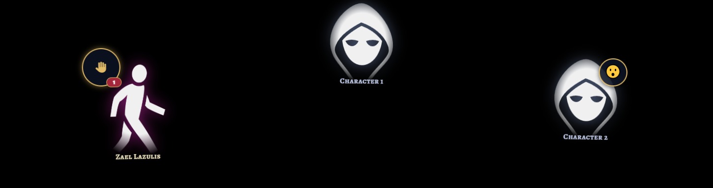
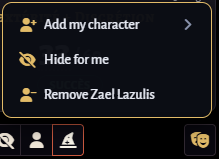

# Better Theater

Bring your characters on stage. Their portraits float gently in an oval around the edges of the screen, like a
circle of storytellers around the table, and they never get in the way: clicks go straight through to the map.

Player characters stand on the left and right sides; images added by the GM (NPCs, creatures, places…) take the
top of the circle. Everyone at the table sees the same circle, adapted to their own screen.

Available in **English** and **French**.

## Putting someone on stage

- The **🎭 button** next to the chat opens the theater menu.
- From a character sheet: **Add to theater** in the sheet's header menu.
- From a token: the theater button in the token's right-click panel.
- From the Actors tab: right-click a character, **Add to theater**.
- Or simply drag a character from the Actors tab and drop it on the 🎭 button.

The portrait uses the character's artwork and name, and follows them if they change. If you used Theatre Inserts
before, the portraits you chose there are picked up automatically.

## For players

- Add your own character (or choose among yours if you have several).
- Click your portrait to open its menu:
  - pick an **emotion** (😄 😏 😮 🤔 😢 😠 😨 ❤️), shown as a small badge; click it again to clear it;
  - **mirror** the portrait so it faces the other way;
  - **open the sheet**, or **remove** the character from the theater.
- **Hide for me**: hides the theater on your screen only (Alt+H). Nobody else is affected.

Players can only change their own characters. Other portraits stay out of their way and let clicks through.

## For the GM

- **Add an image**: pick any picture; its file name becomes the portrait's name.
- **Add a character**: a searchable list, player characters first; tick or untick to put them on stage.
- Click any portrait to:
  - **spotlight** it (it grows bigger, for that dramatic entrance);
  - **rename** it (handy for "Mysterious stranger");
  - set an emotion, mirror it, open the sheet or remove it.
- **Hide for everyone**: lowers the curtain. Players no longer see the theater; you still see it, faded, so you can
  prepare the next scene. A gold dot on the 🎭 button reminds you the curtain is down.
- **Clear the theater**: removes every portrait at once (asks for confirmation first).

## Speech bubbles

When a character on stage speaks in the chat, their line appears for a few seconds in a bubble next to their
portrait, and the portrait lights up while they talk. Just type in the chat as usual: the line is spoken by the
token you have selected, or else by your own character.

No bubble for dice rolls, private messages, or lines sent with `/ooc` (out of character).

## Raise your hand

Players can ask for the floor without interrupting, like in a video call:

- Press **Alt+L**, or use the ✋ button in your portrait's menu. Press again to lower your hand.
- A ✋ with your place in line appears on your portrait and next to your name in the players list (bottom left),
  even if your character isn't on stage.
- The GM hears a short sound and sees the number of raised hands on the 🎭 button. The theater menu lists them in
  order: click a name to **give them the floor**. Their hand goes down, their portrait lights up for everyone, and the
  player gets a message telling them it's their turn.
- The GM can also lower one hand, or all of them at once.
- A player who leaves the game automatically lowers their hand.

## Settings

| Setting | Who | What it does |
|---|---|---|
| Maximum portraits shown | GM, whole table | 8, 10, 12 or 16. Beyond that, the GM's oldest images are tucked into a "+N" badge. Player characters always stay visible. |
| Speech bubbles | GM, whole table | Turn chat bubbles on or off. |
| Portrait size | Each player | Small, normal or large, on your own screen. |
| Raised hand sound | GM | The little sound when a player raises their hand. |

## Shortcuts

- **Alt+H**: hide / show the theater on your screen.
- **Alt+L**: raise / lower your hand (players).

Both can be changed in **Configure Controls**.

## Good to know

- Character sheets and dialog windows always stay in front of the theater, so portraits never cover what you're
  reading.
- The GM needs to be connected for changes to the theater to go through.
- On Foundry's "low" graphics quality, portraits stop floating to save resources.

## Compatibility

Foundry VTT v13 and v14. Works with any game system; no other module needed.

## License

MIT.
